# {{page.blog_title}}

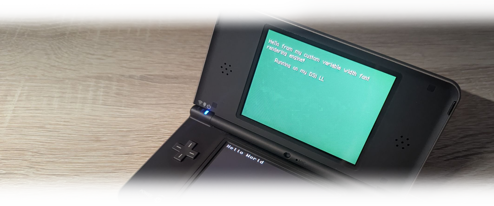

## Motivation & Background

After getting used to the architecture of the NDS and the little quirks of its graphics pipeline, I wanted to test my knowledge and approach a more difficult issue, which still had a practical purpose.

One part that particularly interested me was how text for things like game text boxes is rendered on the console. And I quickly noticed that while the concept in itself sounds rather simple, in practice it's way more difficult than it seems when we want the font to look more clean and pretty.

If our goal is to put text on the screen as simply as possible, the task is relatively straightforward. We just utilize a fixed-width font where we constrain each character within an 8x8 px size so that it fits within a single tile. We then reserve a tileset entry for each character, which gives us a direct mapping between the tileset index and the character glyph. To draw a character, we assign the character's respective tileset entry to the target tileset position where we want it to be placed on the screen, which looks something like this:


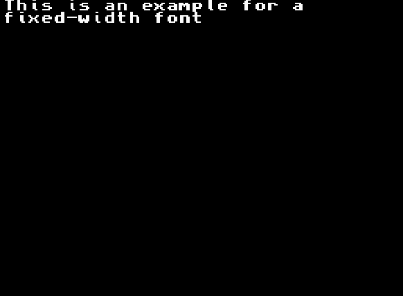{: width="50%" }

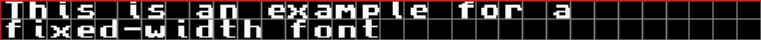{: width="50%" }

However, when looking at this, multiple issues become apparent. First, we are entirely restricted to the tilemap resolution and can only place characters at 8-pixel intervals. Second, as a result of this restriction, the distance between each character, as the name implies, is "fixed", which leads to narrow characters like "i" taking up exactly the same space as wide characters like "W".

If we look at commercial games, we see a completely different picture. For example, as inspiration for this project I have looked at Pokemon Emerald for the GBA as well as Pokemon Mystery Dungeon for the NDS. Taking a closer look at their text rendering, both games utilize a variable-width font engine that respects the individual pixel width of each glyph before drawing the next character. As a result, characters are placed completely independently of the underlying tile grid, despite still being utilizing tiles.


<div style="display: flex; gap: 12px; align-items: flex-start; margin-bottom: 12px;">
  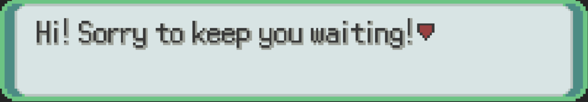
  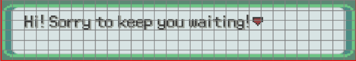
</div>
<div style="display: flex; gap: 12px; align-items: flex-start; margin-bottom: 12px;">
  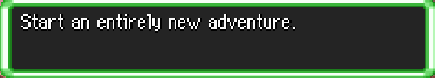
  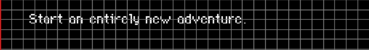
</div>

That was the goal I had in mind. In addition to the rendering pipeline itself, the font data also had to be packed into the ROM. Because we aren't following the hardware's native tile format anymore, we can get much more creative with how we store our glyphs. At a high level, we have the following tasks:
- Encode and store a character set inside the ROM
- Load and reassemble the character alongside its width metadata
- Dynamically draw the character onto a tile-based canvas

## Storing the Character


Step one is getting the characters onto the NDS in a fully self-contained format. I did not want to pixel every glyph from scratch for this project, so I relied on existing TTF fonts as a base, which gave me full freedom over which fonts to use. Since TTFs are vector-based, the first step was to rasterize them and extract all necessary metadata, such as each character's pixel width. For this, I wrote a Python script using Pillow to load a TTF font and rasterize all alphanumeric ASCII characters onto individual 16x16 px binary canvases. While iterating through the characters, the script also captures the corresponding character code as well as the glyph's actual pixel width determined from the rasterized image.

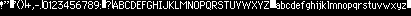{: width="300%" image-rendering: pixelated;"}

Since we don't want to waste ROM space, and our rasterized font is monochrome anyway, storing it in standard 8bpp format would waste us 7 bits per pixel. Instead, we compress each character down to 1bpp, resulting in each 16x16 glyph taking up just 32 bytes. While this requires unpacking the data at runtime on the hardware, it offers several advantages, as described in the later sections. We then serialize all characters in order into a 1D bitstream. In addition, we serialize the width data as an array of 8-bit integers for each respective character and prepend it before the pixel data (with additional padding, so 32-bit alignment is maintained).


We also need to provide context metadata so our binary blob can be interpreted correctly by the engine. For this, I defined a universal character header included with every exported font. Generating every font with this struct allows for uniformity and makes swapping fonts simple:


```C++
struct CharData {

    // Mapping function
    using MapFn = std::optional<uint16_t> (*)(uint16_t input_char);

    const uint16_t version;     // Future proofing for future standards
    const uint8_t font_dim;     // Future proofing for different font sizes, currently only 16x16
    const uint8_t char_cnt;     // Number of Characters padded to the next 32b boundary
    const uint8_t char_size_u8; // (Future proofing) Size of a single glymph in bytes
    const uint8_t* widths;      // Width of all characters as binary
    const uint8_t* pixels;      // 1bpp pixel data as binary
    const MapFn map_fn;         // The character atlas mapping function

    CharData() = delete;
};
```

Here, one important thing of note is the map_fn function pointer, which needs a little background. Initially (and for my test cases), I only exported a simple ASCII alphanumeric range and hardcoded a basic offset calculation (idx = x - 0x21), but I quickly noticed how constraining that is. For example, if I wanted to include a German umlaut character like "Ä" (0xC4), a direct offset implementation would require including every unused character and control symbol in between (or padding the ROM with empty space) just to keep the index math intact. Furthermore, if I wanted to include Unicode symbols or custom raster with no corresponding ASCII index, a simple offset would fail to map correctly.

My solution was to bundle a custom mapping function with each exported font. For any given unsigned 16-bit character code, this function returns either the corresponding glyph index in memory or std::nullopt. This gives us complete flexibility for each font to define its own character set independently, while maintaining a uniform structure.

## The Text Canvas

With our character data prepared and exported, we can move onto the NDS hardware itself. Before we can render the font, we first need a canvas to draw our pixel data onto. As we are still working with tiles here, we can place our canvas anywhere on the screen within the 8x8 tile grid resolution. For example, we can confine our text canvas to a dialogue box on the lower part of the screen, or cover the entire screen if we want.

Initialization works by sequentially assigning each tilemap entry within our canvas a unique index in the tileset, while pointing all tilemap entries outside our canvas to tileset index 0 (which remains reserved as a blank, transparent tile). The following figure shows how this structured layout looks in practice:

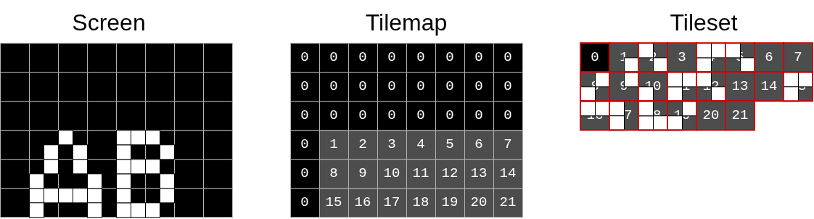

To describe where to draw next within a canvas, I store a cursor position defined as a pixel offset from the top-left corner of the canvas. Those cursor positions can be deconstructed to a tile offset as well as the pixel offset within a given tile. The cursor logic is contained within the following struct:

```C++
struct TextCursor{

    u8 pos_x;
    u8 pos_y;

    constexpr u8 tile_x() const { return pos_x >> 3; }
    constexpr u8 tile_y() const { return pos_y >> 3; }

    constexpr u8 stride_x() const { return pos_x & 7; }
    constexpr u8 stride_y() const { return pos_y & 7; }

};
```

## Loading and Drawing a Character


Before unpacking and drawing a character, I first allocate a staging buffer of 3x3 tiles in WRAM where the existing tile data is loaded before being written back to VRAM. This is done because VRAM access is slower than WRAM, doesn't support 8-bit writes, and requires multiple passes over the buffer to composite shadows and foreground pixels. By working in a temporary buffer, we can reduce VRAM traffic to a single read and write burst per character. Our final pipeline overview looks like this:

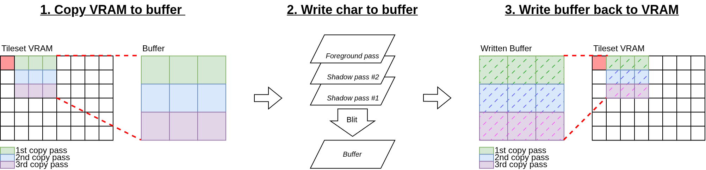{: width="150%" }

Here it is to note that, while our 16x16 px font fits inside a 2x2 tile area, we need a 3x3 tile buffer to capture any overhead on the right and bottom edges when a character is drawn at a larger inner-tile pixel offset (dx and dy), as demonstrated in the following figure:

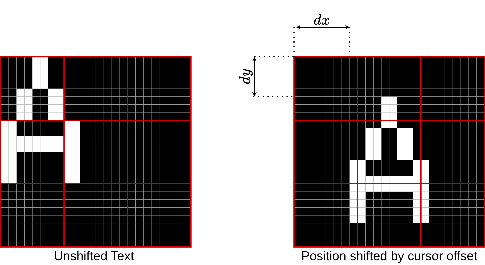{: width="60%" }


The next part is the core of the entire operation. The rendering function iterates over the 16 pixel rows of our character, starting at the cursor's vertical inner-tile offset. For each row, we load the two bytes representing the 16 horizontal pixels of the glyph into the upper half of a single 32-bit register:

```C++
u8 tile_a = *(src_addr);
u8 tile_b = *(src_addr + 1);

u32 ext_char = ((static_cast<u32>(tile_a) << 24) | (static_cast<u32>(tile_b) << 16));

```

To place the character at the correct horizontal cursor offset, we need to shift the pixel data across the 3-tile row. Because the character row is still compressed as 1bpp inside a single 32-bit integer, we can shift the entire row across tile boundaries with a single right shift by the inner-tile X offset:


```C++
ext_char = ext_char >> (text_cursor.stride_x() + shadow_off_x);
```

To have the data renderable by the VRAM, we expand the data from 1bpp to 4bpp using an 8b expansion LUT (which also reverses the bit order for free, as needed for the VRAM):

```C++
constexpr uint32_t expand_byte(uint8_t byte) {
    uint32_t val = 0;
    for (int bit = 0; bit < 8; bit++) {
        if (byte & (1 << ( 7 - bit))) {
            val |= (0x1u << (bit * 4));
        }
    }
    return val;
}

constexpr auto make_lut() {
    std::array<uint32_t, 256> table{};
    for (int i = 0; i < 256; ++i) {
        table[i] = expand_byte(static_cast<uint8_t>(i));
    }
    return table;
}
```

Indexing into this LUT gives us the finished three-tile row distributed across three 32-bit variables:

```C++

for(int j = 0 ; j < 3; j++){
    char_wram_row_data[j] =
        lut_1b_to_4b[static_cast<u8>(ext_char >> (tile_size_u32 * (3 - j)))];
}

```

Repeating this for all 16 rows and writing the result back to VRAM gives us basic text rendered in whatever color is stored at palette index 0x1. However, looking back at our reference games, their text also features a drop shadow.

Initially, I assumed I had misjudged how the reference games stored their fonts and that the glyphs were actually encoded as 2bpp with the shadow baked into the bitmap. Upon closer inspection, however, I noticed that the shadows are generated dynamically at runtime by simply drawing the character multiple times: first offset 1px to the right, second offset 1px to the bottom, both using a shadow palette color, before drawing the final pass in the foreground color:

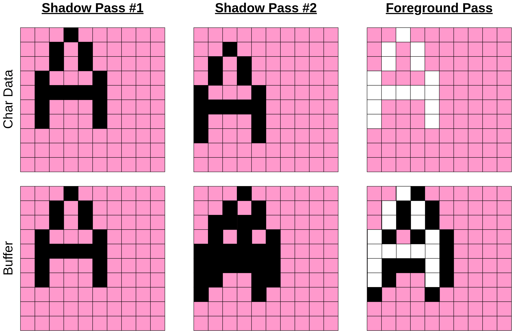{: width="90%" }

Because the sub-tile offset logic was already there, this was simple to implement. All it took was running the drawing loop two extra times with the shadow offsets before drawing the main foreground glyph.

Assigning the shadow is just as simple. We hook into the existing architecture right after expanding the 1bpp row through the LUT. Because every active pixel in our three 32-bit variables is represented as 0x1 in its respective 4-bit nibble, we can assign any palette index by multiplying the entire 32-bit word by our target palette index. This is equivalent to a SIMD multiplication of each seperate nibble, as long we do not multiply by more than 16, which is larger than the total number of avaliable colors anyway. In addition to setting a shadow color, we also can assign any foreground colors we want this way.

Finally, each pass needs to be merged into our buffer without overwriting pixels drawn by previous characters or passes. To archive this, we generate a 4bpp bitmask by multiplying the raw 0x1 LUT output by 0xF, clear those target nibbles in the buffer, and OR in our colored pixel data:


```C++
    char_wram_row_data[j] =
        lut_1b_to_4b[static_cast<u8>(ext_char >> (tile_size_u32 * (3 - j)))];

    // Set the override mask, to override the shadow values
    u32 mask = char_wram_row_data[j] * 0xF;

    // Set Character color, or fix to shadow color
    char_wram_row_data[j] *= pass < 2 ? 1 : color;

    // Merge with the tileset WRAM copy
    tileset_copy[row_stride * tile_size_u32*3 + row_off + 8*j ] =
        (tileset_copy[row_stride * tile_size_u32*3 + row_off + 8*j] & ~mask) | char_wram_row_data[j];
```

Once all passes for the character are written to the WRAM buffer, we copy the modified 3x3 tiles back to VRAM to display the character on screen. Below is a visualization of the character drawing pipeline for a single row:

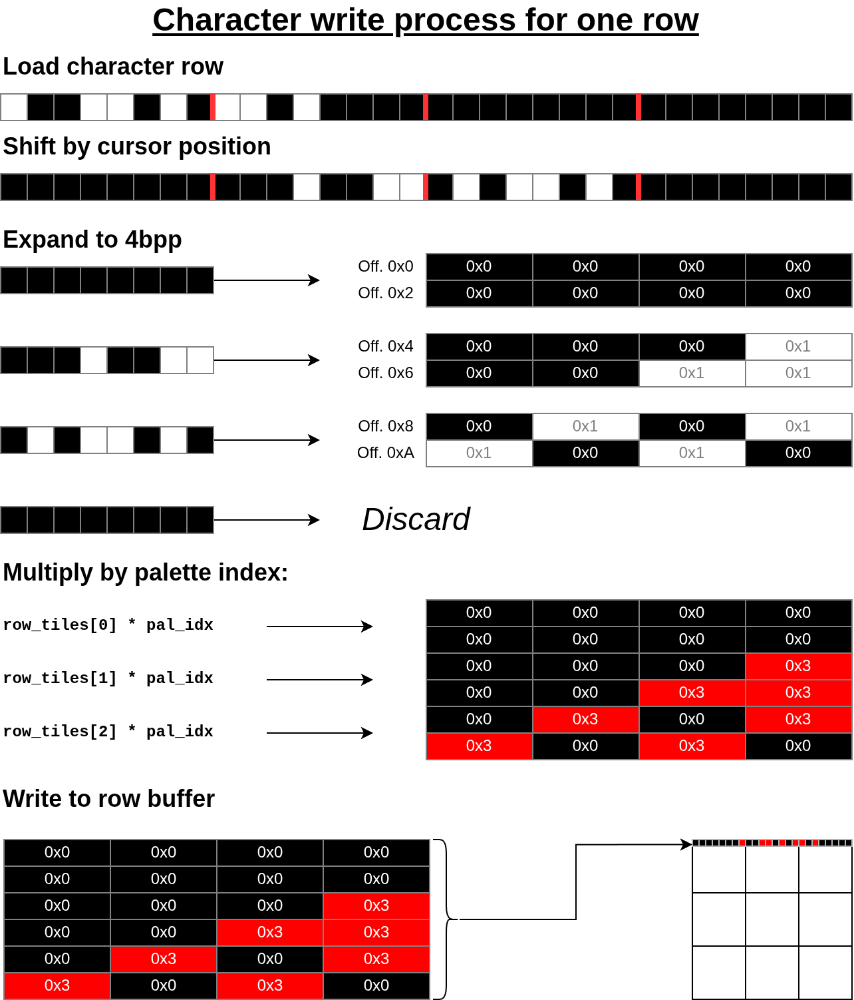{: width="80%" }

## Everything Else

With the core blitting routine finished, everything left is glue logic and string formatting. Using the character width array and our cursor struct, we advance `pos_x` by the glyph's width after each draw call, and reset `pos_x` while advancing `pos_y` whenever we hit a newline. Wrapping this inside a string parser lets us render full sentences. Of course we also need to make everything waterproof, so the library does not write out of bounds into invalid memory.

## The Result


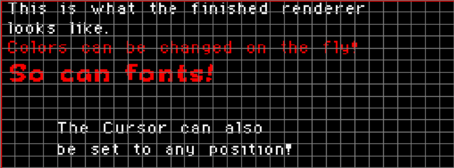

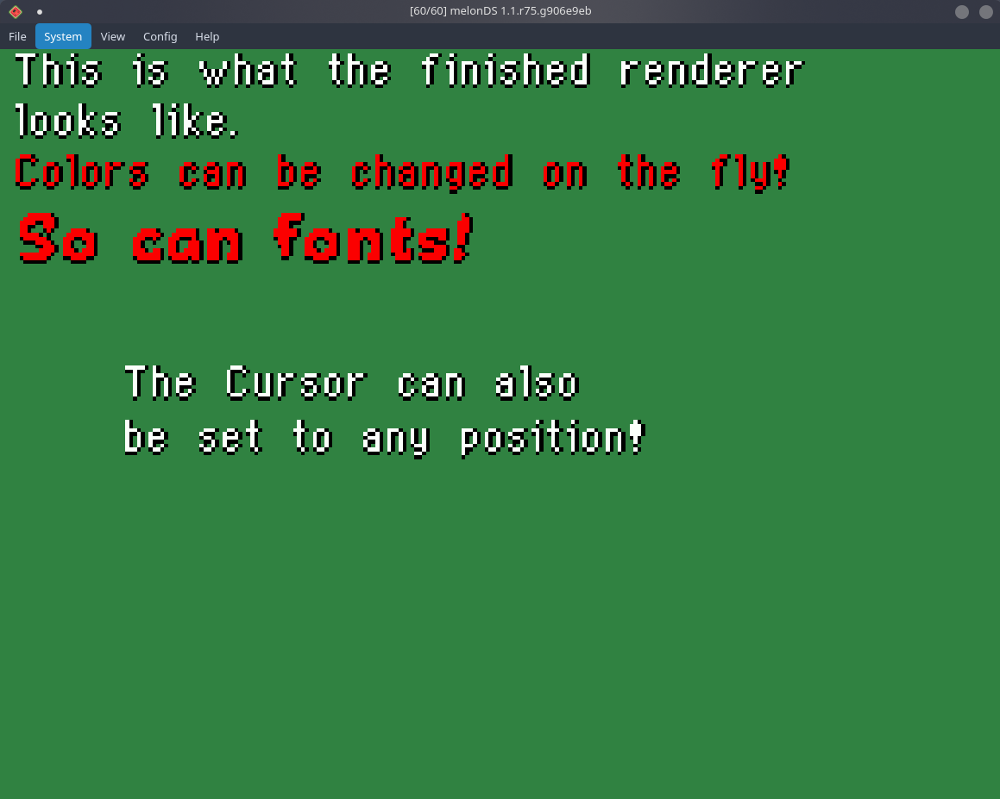

## What is Left to Do?

As the project is still a work in progress, there are still a few features left to implement:

- A higher-level string parser that accepts inline meta-commands (such as mid-sentence color changes, pauses, or dynamic variable substitutions)

- Automatic word-width lookahead to properly line-wrap text before it clips the right edge of the canvas

- The iconic RPG "typewriter" effect that draws characters sequentially over frames, including optional sound effects
